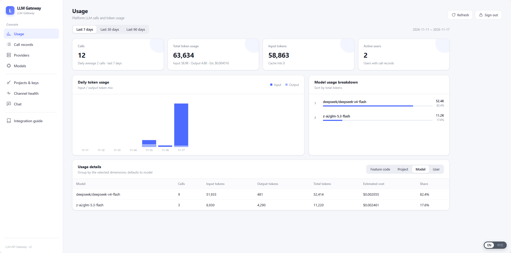
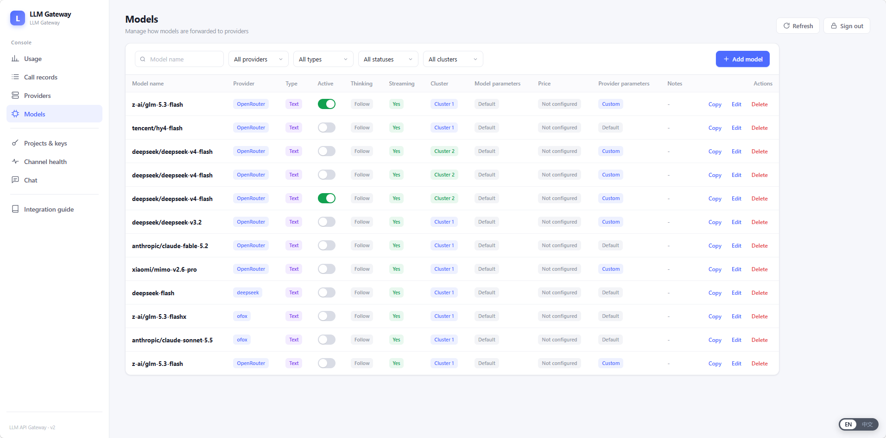
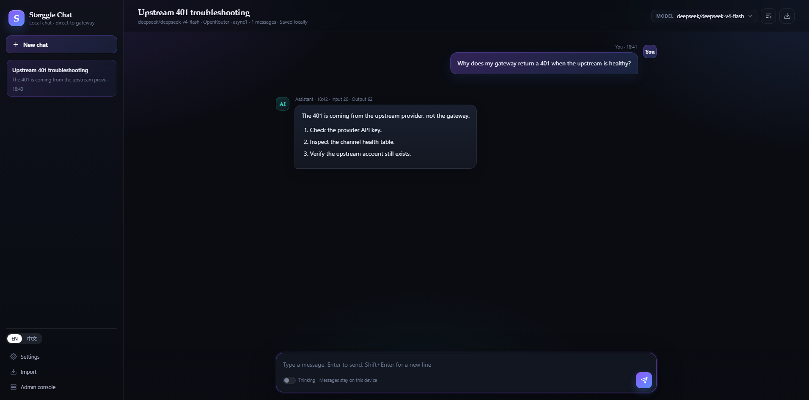

# LLM Gateway

[English](README.md) | **简体中文**

一个轻量的多厂商大模型统一接入网关：用 OpenAI 兼容协议对接多家模型服务，
在管理台统一维护提供商、模型、集群与请求参数，并记录调用用量。网关负责调用层的脏活——
协议差异、重试、故障切换、配额、用量与日志，业务侧只需要一个 OpenAI 兼容客户端。

> [!WARNING]
> 默认管理员账号是 `admin / admin`，`JWT_SECRET_KEY` 是占位符，**仅用于本机体验**。
> 部署到局域网或公网前，必须先修改 `ADMIN_USERNAME`、`ADMIN_PASSWORD` 和 `JWT_SECRET_KEY`。
> 请勿把 `.env`、`data/`、数据库文件或日志提交到仓库。

## 适合谁

面向企业内部后端和小团队：业务接口、后台批任务、报表生成，或需要独立配额与故障隔离的多条
业务线。

- **适合**：少量运维人员、内部流量、OpenAI 兼容客户端、单机 SQLite；需要多实例时切换 MySQL
- **不适合**：对外多租户 API 售卖、按用户充值计费、跨部门 RBAC、Agent 聊天日志分析；
  这些场景请选择 new-api、one-api 或 LiteLLM

网关负责调用层治理：厂商协议、重试、熔断、配额、用量与日志；业务侧仍然负责 prompt 设计、
结果校验和业务兜底。

## 特性

- **多厂商统一接入**：OpenAI 兼容 `POST /chat/completions`，支持流式（SSE）与非流式
- **提供商集中配置**：API 地址与 Key 在提供商层统一维护，模型引用提供商配置
- **模型集群与轮询**：模型按 `async1..async9` 划分为 9 个集群，同集群内自动轮询。可用不同集群隔离主业务、后台批任务和报表生成，避免批任务挤占核心链路
- **项目与 API Key**：按项目签发 `sk-gw-...` Token，支持吊销、轮换与模型范围限制
- **项目配额**：每日/每月调用次数、Token 数与成本上限
- **渠道健康**：成功率、延迟、熔断/冷却，同集群内自动换渠道重试
- **成本路由**：每个集群可选轮询、成本优先或延迟优先
- **厂商参数适配**：内置 DeepSeek/GLM/MiniMax/Claude/Gemini/Qwen 等思考参数与协议差异处理
- **模型级参数覆盖**：`temperature` / `top_p` / `top_k` / `max_tokens` 可按模型覆盖
- **用量统计**：Token 用量、调用记录、按项目/模型/功能码/用户分组
- **成本估算**：模型配置输入/输出单价后，按调用记录估算成本（OpenRouter 可直接用上游返回的实际扣费）
- **请求追踪**：`X-Request-Id` 透传/生成，响应头带实际模型、集群与重试次数
- **管理台**：提供商、模型、集群、项目、密钥、渠道健康与接入说明一体化
- **内置聊天页**：`/chat` 提供离线 Chatbox 风格界面，会话保存在浏览器本地，支持流式、停止、重新生成、导入/导出
- **报文日志开关**：默认把完整 LLM 请求与响应写入服务端日志，可在「渠道健康」关闭；日志可能包含用户提示词
- **中英双语界面**：默认英文，右下角可一键切换中文
- **单管理员模式**：环境变量配置账号，JWT 登录，无需额外用户系统
- **零配置存储**：默认 SQLite，开箱即用；需要多实例时可切换 MySQL

## 横向对比

LLM Gateway 不是 LiteLLM / new-api 的替代品。它面向小型自托管场景：想要一个紧凑、
SQLite 优先、带集群路由、渠道健康和项目配额的网关，但不需要多租户用户体系。

| | LLM Gateway | [LiteLLM](https://github.com/BerriAI/litellm) | [new-api](https://github.com/QuantumNous/new-api) | [one-api](https://github.com/songquanpeng/one-api) |
|---|---|---|---|---|
| 许可证 | Apache-2.0 | MIT | AGPL-3.0 | MIT |
| 技术栈 | Python / FastAPI | Python | Go / React | Go |
| 管理模型 | 环境变量单管理员 | 多用户、团队、虚拟 Key | 多用户、分组、OAuth | 多用户、分组 |
| 提供商 | 预设清单，可添加任意 OpenAI 兼容端点 | 100+ 集成 | 40+ 提供商 | 多种 OpenAI 兼容提供商 |
| 路由 | 9 个集群（`async1..async9`）；轮询、成本优先、延迟优先 | 加权、最少繁忙、延迟、用量、成本、回退链 | 渠道分组 + 优先级/权重 | 渠道分组、优先级、负载均衡 |
| 渠道健康 | 成功率、延迟、熔断、半开探测 | 重试、冷却、回退 | 渠道测试、自动禁用 | 渠道测试、自动禁用 |
| 配额 | 按项目：每日/每月调用数、Token、成本 | 按 Key/用户/团队预算 | 用户与 Token 配额、在线充值 | 用户与 Token 配额、兑换码 |
| 存储 | SQLite（默认）/ MySQL | PostgreSQL（+ Redis） | SQLite / MySQL / PostgreSQL（+ Redis） | SQLite / MySQL / PostgreSQL（+ Redis） |

### 限制

- 没有虚拟模型层：模型直接对应真实渠道，不支持 prompt/模型组合
- 只有环境变量配置的单管理员，没有 RBAC 或独立子账号
- 每个集群只有轮询、成本优先、延迟优先三种策略，不支持权重、优先级或基于质量的模型选择
- 没有内置告警或 Prometheus 导出，目前依靠渠道健康看板和日志管道
- 没有 guardrails 或内容策略层
- 提供商是预设清单，不是 100+ 集成
- SQLite 只适合单进程；多 worker 或多实例请用 MySQL
- 多实例状态存在 MySQL 中，没有 Redis 路由/限流缓存

*对比基于 2026 年 11 月的公开文档，欢迎通过 Issue 指正。*

## 界面截图







## 环境要求

一键脚本和手动启动都需要 Python **3.10+**；使用 Docker 可以不装本地 Python。

**Windows**

从 <https://www.python.org/downloads/windows/> 下载安装包，安装时勾选 **Add python.exe to PATH**。
安装完成后打开新终端检查：

```bash
python --version        # 或：py -3 --version
```

**macOS**

从 <https://www.python.org/downloads/macos/> 安装，或使用 Homebrew：

```bash
brew install python
python3 --version
```

**Linux（Debian / Ubuntu）**

```bash
sudo apt update
sudo apt install -y python3 python3-venv python3-pip git
python3 --version
```

如果发行版自带的 Python 低于 3.10，请从 <https://www.python.org/downloads/> 安装新版本，
或使用 `pyenv`。

使用 Docker 时改为安装 Docker Desktop（Windows/macOS）或带 Compose v2 的 Docker Engine。

## 最简单：一键启动

需要 Python 3.10+，详见[环境要求](#环境要求)。

- **Windows**：双击 `start.bat`
- **macOS / Linux**：`bash start.sh`（ZIP 下载丢失执行权限时也能运行）

脚本会自动创建虚拟环境、安装依赖、生成 `.env`、启动服务并打印管理台地址
（Windows 会同时打开浏览器）。默认地址 <http://127.0.0.1:9010/>，默认账号 `admin / admin`。

> 一键脚本默认只监听 `127.0.0.1`。需要局域网或服务器访问时，运行
> `HOST=0.0.0.0 bash start.sh`，并在防火墙或云安全组放行 9010 端口。

> 默认账号只适合本机使用；如果要对局域网或公网开放，先修改 `.env` 中的
> `ADMIN_USERNAME` / `ADMIN_PASSWORD` / `JWT_SECRET_KEY`。

## 快速开始（Docker）

```bash
cp .env.example .env
# 修改 .env 中的管理员账号与 JWT_SECRET_KEY
docker compose up -d --build
```

打开 <http://localhost:9010/>，使用 `.env` 中的管理员账号登录。

默认使用 SQLite，数据库文件持久化在 `gateway_data` 卷中，无需额外数据库服务。

## 手动启动（本地开发或 Linux 服务器）

```bash
git clone https://github.com/MrStarggle/llm-gateway.git
cd llm-gateway

python3 -m venv .venv            # Windows: py -3 -m venv .venv
source .venv/bin/activate        # Windows: .venv\Scripts\activate
pip install -r requirements.txt
cp .env.example .env

uvicorn main:app --host 0.0.0.0 --port 9010
```

应用启动时会自动建表，数据库默认写入 `data/gateway.db`。部署到服务器时，
`--host 0.0.0.0` 才能从外部访问；请在防火墙或云安全组放行 9010 端口。

> SQLite 适合单机单进程部署。不要同时启动多个 uvicorn worker 或多个实例共享同一个
> SQLite 文件；需要多实例/高并发写入时，请切换到 MySQL。

## 测试

测试只依赖 Python 标准库，使用独立的临时 SQLite 文件，不会修改 `data/gateway.db`：

```bash
python -m unittest discover -s tests -v
```

也可以安装 `requirements-dev.txt` 后用 pytest 运行。

## 配置

| 环境变量 | 说明 | 默认 |
|---|---|---|
| `DB_BACKEND` | `sqlite` 或 `mysql` | `sqlite` |
| `SQLITE_PATH` | SQLite 数据文件路径 | `data/gateway.db` |
| `DATABASE_URL` | 显式 SQLAlchemy 异步连接串，优先级最高 | 空 |
| `MYSQL_HOST` / `MYSQL_PORT` / `MYSQL_USER` / `MYSQL_PASSWORD` / `MYSQL_DATABASE` | MySQL 连接（`DB_BACKEND=mysql` 时使用） | localhost / 3306 / root / 空 / `llm_gateway` |
| `ADMIN_USERNAME` / `ADMIN_PASSWORD` | 管理台登录账号（明文保存在 env，单管理员） | `admin` / `admin` |
| `JWT_SECRET_KEY` | JWT 签名密钥，生产必须修改 | 代码默认 `dev-only-change-me`；示例文件里是占位符 |
| `HOST` | `start.sh` / `start.bat` 的监听地址 | `127.0.0.1` |
| `PORT` | `start.sh` / `start.bat` 与 `python main.py` 使用的端口；Docker 使用 compose 端口映射 | `9010` |
| `GATEWAY_DEBUG` | `1` 时错误响应包含调试信息 | `0` |
| `GATEWAY_TOKEN_REQUIRED` | `1` 时所有调用必须带 `sk-gw-` 项目 Token | `0` |
| `USAGE_RETENTION_DAYS` | 原始调用明细保留天数；`0` 不清理 | `90` |
| `CORS_ORIGINS` | 跨域管理台来源，逗号分隔 | 空（同源即可） |

### 管理员账号

开源版没有用户表，只有一组环境变量管理员账号：

```bash
ADMIN_USERNAME=admin
ADMIN_PASSWORD=admin
JWT_SECRET_KEY=change-me-to-a-long-random-string
```

- 改账号/密码：修改 `.env` 后**重启服务**，已签发的 JWT 在过期前仍然有效（默认 7 天）
- 改 `JWT_SECRET_KEY`：所有已签发 token 立即失效
- 没有注册、找回密码、多用户；需要这些能力就按「接入自有用户体系」替换鉴权层
- 默认 `admin / admin` 仅适合本机；对局域网或公网开放前必须修改

### SQLite 数据与备份

默认数据库是单文件 `data/gateway.db`，首次启动自动创建。

```bash
# 停止服务后直接复制即可
cp data/gateway.db data/gateway.db.bak
```

WAL 模式下会同时存在 `gateway.db-wal` / `gateway.db-shm`；运行中需要备份时用：

```bash
sqlite3 data/gateway.db ".backup 'data/gateway.db.bak'"
```

Docker 部署时数据在 `gateway_data` 卷里，不要删除该卷。

### 切换到 MySQL

先在 MySQL 中建库（表由程序启动时自动创建）：

```sql
CREATE DATABASE IF NOT EXISTS llm_gateway
  CHARACTER SET utf8mb4 COLLATE utf8mb4_unicode_ci;
```

然后在 `.env` 中配置：

```bash
DB_BACKEND=mysql
MYSQL_HOST=127.0.0.1
MYSQL_PORT=3306
MYSQL_USER=root
MYSQL_PASSWORD=your-password
MYSQL_DATABASE=llm_gateway
```

MySQL 模式会在启动时执行 `app/db/schema.sql` 与幂等迁移。
SQLite 和 MySQL 之间没有自动数据迁移；切换前需要自己导出/导入。

### 安全与部署提示

- 公网部署前必须修改 `ADMIN_USERNAME` / `ADMIN_PASSWORD` / `JWT_SECRET_KEY`
- 建议放在 HTTPS 反向代理（Nginx/Caddy）之后，并在代理层加登录限流
- SQLite 模式只运行一个进程，不要使用多个 worker 或多个实例共享同一文件
- 完整 LLM 请求/响应报文默认**写入服务端日志**；可在「渠道健康 → LLM 报文日志」关闭。日志可能包含用户提示词，请妥善保管
- 项目 Token 只保存 SHA-256 哈希，完整密钥仅在创建/轮换时返回一次
- 网关 Token 不会转发给上游；上游 Key 始终使用服务端配置
- 渠道健康只保存错误类型/HTTP 状态码，不保存上游错误报文，避免提示词片段落库

### 接入自有用户体系

开源版默认是单管理员模式：`app/api/v1/controller/auth_controller.py` 用 env 中的
`ADMIN_USERNAME` / `ADMIN_PASSWORD` 校验并签发 JWT，全程不查用户表。

如果要接入你自己的用户表/OAuth/SSO，只需要替换两处：

- `auth_controller.py`：登录接口改为校验你自己的用户
- `admin_auth.verify_admin_token`：改为校验你的 token（或复用同一套 JWT）

管理接口统一通过 `Depends(verify_admin_token)` 鉴权，替换这一层即可。

## 调用

推荐直接使用 OpenAI 兼容入口 `/v1/chat/completions`：

```bash
curl -X POST "http://localhost:9010/v1/chat/completions" \
  -H "Content-Type: application/json" \
  -H "Authorization: Bearer sk-gw-你的项目Token" \
  -H "X-Async-Type: async1" \
  -H "X-Feature-Code: role_reply" \
  -d '{
    "model": "",
    "messages": [{"role": "user", "content": "你好"}],
    "stream": false
  }'
```

兼容入口（与上面等价）：

- `POST /router/call-manage/chat/completions`
- `POST /api/v1/call-manage/chat/completions`

OpenAI SDK：

```python
from openai import OpenAI

client = OpenAI(
    base_url="http://localhost:9010/v1",
    api_key="sk-gw-你的项目Token",
    default_headers={"X-Async-Type": "async1"},
)
resp = client.chat.completions.create(
    model="",
    messages=[{"role": "user", "content": "你好"}],
)
```

模型列表：`GET /v1/models` 返回使用中的文本模型；传入 `sk-gw-` 项目 Token 时按 Token 的模型白名单过滤。响应中的 `x_clusters` 可直接作为 `X-Async-Type` 使用。

请求头：

| 请求头 | 取值 | 说明 |
|---|---|---|
| `Authorization` | `Bearer sk-gw-...` | 项目 Token；网关校验项目、配额与模型范围，且不会转发给上游 |
| `X-Async-Type` | `async1`..`async9` | 模型集群；不传时主链默认 `async1`、异步链默认 `async2` |
| `X-Purpose` | `main` / 任意以 `async` 开头的标识 | 异步判定、日志与用量统计；不影响集群选择 |
| `X-Thinking` | `1` / `0` | 思考开关；仅在模型思考模式为「跟随请求」时生效 |
| `X-Response-Format` | `json_object` | 要求 JSON 输出 |
| `X-User-Id` | 调用方标识 | 用于调用记录与用量统计 |
| `X-Feature-Code` | 如 `role_reply` | 功能码，用于用量明细分组统计；不传记为 `uncategorized` |
| `X-Request-Id` | 可选，≤64 字符 | 调用链路追踪；不传由网关生成 |

> 不带 `sk-gw-` 前缀的 `Authorization` 仍按旧版语义处理：主链可覆盖服务端上游 Key，
> 异步链强制使用服务端 Key。设置 `GATEWAY_TOKEN_REQUIRED=1` 后必须使用项目 Token。

## 内置聊天页

启动后打开 <http://127.0.0.1:9010/chat>，或从管理台左侧「对话」进入。这是一个轻量的
Chatbox 风格客户端，直接调用网关的 `/v1/chat/completions`：

- 会话和消息保存在浏览器 IndexedDB（不可用时回退 localStorage），不写入网关数据库
- 支持流式输出、停止生成、重新生成、模型切换、系统提示词、导入/导出 JSON
- 本地开源模式可留空 API Key；启用 `GATEWAY_TOKEN_REQUIRED=1` 或使用项目配额时，在「设置」中填写 `sk-gw-...`
- 需要完整客户端时，Chatbox / Open WebUI / Cherry Studio 等可直接使用 `base_url=http://host:9010/v1` 和项目 Token

## 报文日志

完整 LLM 报文默认写入服务端日志。开关位置：**渠道健康 → LLM 报文日志**。

开启时记录：

- 发给上游的请求体
- 非流式调用的完整 JSON 响应
- 流式调用结束后重组出的 `content`、`reasoning_content` 和 `usage`

关闭后只保留摘要：状态码、耗时、字节数和 Token 用量。

开关保存在数据库中（不在 `.env`），当前进程立即生效，其他 worker 最多 15 秒内同步。
日志可能包含用户提示词，请妥善保护日志文件。

## 项目与配额

1. 打开管理台 →「项目与密钥」→ 新增项目
2. 在项目详情创建 Token，复制 `sk-gw-...`。完整密钥只显示一次，关闭后无法查看
3. 客户端用 `Authorization: Bearer sk-gw-...` 调用

项目可设置六项限额：每日/每月 × 调用次数、Token 数、成本。规则：

- 留空 = 不限，`0` = 禁止调用
- 调用次数在请求前检查；Token/成本在响应后累计，属于软限额，最多超一个请求
- 只有成功请求计数；网关内部重试仍算一次逻辑调用
- 成本只累计与项目币种一致的记录，不做汇率换算
- 配额超限返回 `429`，错误码如 `daily_call_quota_exceeded`
- Token 可限制允许的模型，支持 `*` 通配；项目可停用但不会删除历史用量

成功响应会带 `X-Request-Id`、`X-Gateway-Model`、`X-Gateway-Cluster`、
`X-Gateway-Retry-Count`。

## 渠道健康与成本路由

一个「大模型管理」中的模型行视为一个渠道。网关会记录每个渠道的今日成功/失败次数、
平均延迟（流式按 TTFB）、连续失败次数与最后错误，并在「渠道健康」中展示。

- 连续失败达到阈值后熔断，冷却期间不再被选中
- 冷却结束后自动半开探测；成功则恢复，失败则重新熔断
- 同一集群内自动换渠道重试：连接失败、超时、429、5xx、401/403
- 400/404/422 属于请求或模型本身问题，不换渠道重试
- 全部渠道都熔断时仍会尝试，避免整体不可用
- 流式请求在开始向客户端输出前完成重试；一旦开始输出不再换渠道

每个集群可选三种策略：

| 策略 | 说明 |
|---|---|
| `round_robin` | 轮询（默认，兼容旧行为） |
| `cost_first` | 按输入/输出单价估算成本，最低优先；缺价格的排最后 |
| `latency_first` | 按今日平均延迟，最低优先 |

成本估算使用模型的 `input_price_per_1m` / `output_price_per_1m`，
输出占比可在路由配置中调整（默认 0.3）。缺价格或延迟数据时自动退回轮询。

## 项目结构

```
app/
  api/v1/controller/   管理端、模型、项目、渠道健康、调用转发接口
  config/              数据库与运行配置
  db/schema.sql        MySQL 建表脚本（SQLite 由 ORM 自动建表）
  models/              提供商、模型、用量、项目、Token、健康、路由 ORM
  services/            模型选择/路由、用量统计、项目管理、渠道健康
  utils/               JWT、雪花 ID、统一响应、OpenAI 错误格式
templates/model_manage.html   管理台
templates/chat.html           内置聊天页
static/chat/                  聊天页 CSS / JS
static/i18n.js                界面翻译（默认英文，中文为源文案）
tests/                        标准库 unittest 测试
providers.txt                 提供商下拉清单（域名, 名称, 备注）
main.py                       FastAPI 入口
```

## License

Apache-2.0
